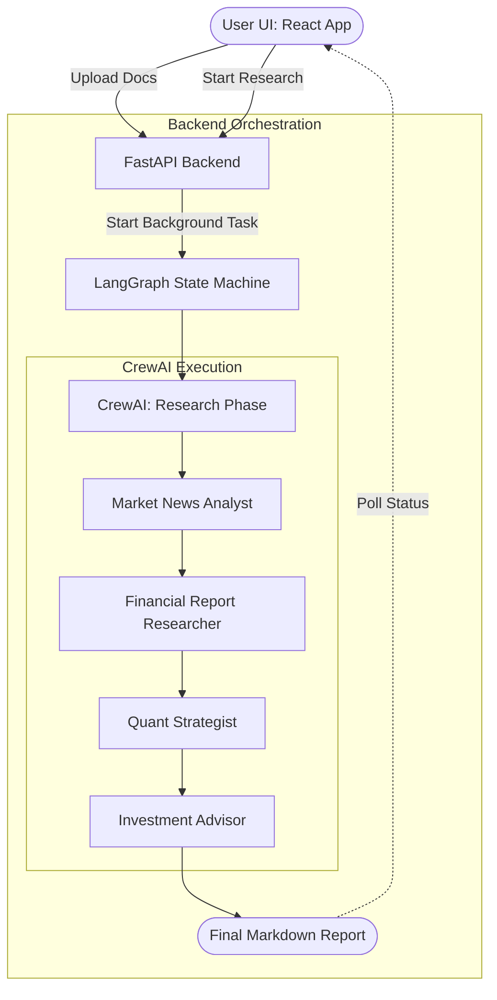

# Agile Alpha

Agile Alpha is a professional-grade, autonomous agentic workflow application designed for automated equity research. 

## System Architecture

The application is built using a modern, decoupled architecture:

### 🏗️ Technical Architecture Table

| Component | Responsibility | Technology Stack |
| :--- | :--- | :--- |
| **Frontend UI** | User Interface & Real-time Progress | React + Vite + Vanilla CSS |
| **Web Server** | API Endpoints & State Management | FastAPI + Uvicorn |
| **Orchestrator** | State Machine & Workflow Flow | LangGraph |
| **Agent Core** | Autonomous Reasoning & Task Handling | CrewAI (Qwen 3.8-27b via Groq) |
| **Memory/RAG** | Local Document Retrieval & Embeddings | ChromaDB + LangChain |
| **Tools** | Web Search, Financial Data, Quant Analysis | DuckDuckGo, yFinance |

### 1. Frontend (React + Vite)
- **UI Framework:** React with Vite for lightning-fast HMR.
- **Styling:** Custom CSS implementing a minimalistic, Wall Street / SaaS aesthetic (dark mode, crisp borders, `Inter` typography).
- **Features:** Single-page routing with a dedicated Terminal and User Manual, real-time backend polling for job status, and linear progress tracking.

### 2. Backend (FastAPI + Python)
- **Web Server:** FastAPI running on Uvicorn provides async, non-blocking HTTP endpoints.
- **Endpoints:**
  - `POST /api/upload`: Ingests user documents (PDF/TXT) into the RAG vector store.
  - `POST /api/research`: Spawns a background `asyncio` task to orchestrate the AI agents.
  - `GET /api/status/{task_id}`: Allows the frontend to poll for task completion.

### 3. AI Orchestration (CrewAI)
The core of the application relies on `CrewAI` to manage a sequential team of specialized agents:
- **Market News Analyst:** Scours the web (via DuckDuckGo) for recent, high-impact events.
- **Financial Report Researcher:** Fetches fundamentals (via Yahoo Finance) and queries the user's uploaded documents (via ChromaDB RAG).
- **Quant Strategist:** Analyzes historical pricing, moving averages, and technical indicators.
- **Investment Advisor:** Synthesizes the data into a final, professional investment thesis.

### 4. Language Model (LiteLLM)
- **Model:** Tuned to use `qwen/qwen3.8-27b` via Groq's API.
- **Rate Limit Handling:** Agents are executed sequentially, and `max_tokens` constraints are strictly enforced to prevent exceeding the free-tier Output Tokens Per Minute (OTPM) limits.
