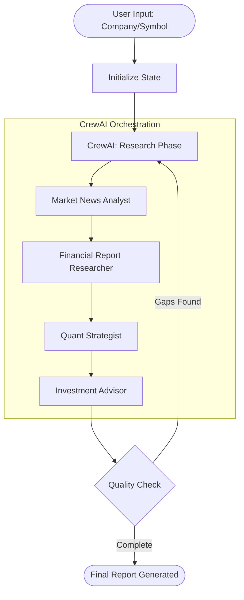

# Agile Alpha: AI-Driven Market Intelligence Crew

Agile Alpha is a sophisticated investment research platform that uses a coordinated crew of AI agents to perform deep-dive market analysis. It combines real-time web search, internal document RAG (Retrieval-Augmented Generation), and quantitative financial data to produce comprehensive investment strategies.

## 🚀 What It Does
The system takes a company name and stock symbol, then orchestrates four specialized agents to:
1.  **Analyze Sentiment**: Scour the live web for recent news and market mood.
2.  **Research Fundamentals**: Search through local financial reports (PDFs/TXTs) for specific metrics.
3.  **Perform Quant Analysis**: Pull real-time price trends and analyst targets from Yahoo Finance.
4.  **Synthesize Strategy**: Combine all findings into a final 500-word investment recommendation.

## 🏗️ Architecture & Flow
The project uses **LangGraph** to manage the state and **CrewAI** to execute agent tasks.



### 🏗️ Technical Architecture

| Component | Responsibility | Technology Stack |
| :--- | :--- | :--- |
| **Orchestrator** | State Machine & Workflow Flow | LangGraph |
| **Agent Core** | Autonomous Reasoning & Task Handling | CrewAI (Llama 3.1-8b via Groq) |
| **Memory/RAG** | Local Document Retrieval & Embeddings | ChromaDB + LangChain + HF Inference |
| **Tools** | Web Search, Financial Data, Quant Analysis | DuckDuckGo, yFinance |

### Key Components:
-   **Knowledge Layer**: LangChain + ChromaDB (Vector Store) using HuggingFace Inference API.
-   **Execution Layer**: CrewAI Agents powered by Groq (Llama 3.1).
-   **Control Layer**: LangGraph State Machine for workflow orchestration.

## 📂 Project Structure
```text
Agile Alpha/
├── data/               # Local financial documents (PDF/TXT) for RAG
├── db/                 # ChromaDB Vector Store (ignored by git)
├── venv/               # Python Virtual Environment
├── main.py             # Entry point (LangGraph initialization)
├── agents.py           # CrewAI Agent definitions & LLM config
├── tasks.py           # Specific tasks assigned to agents
├── rag_pipeline.py     # RAG logic & HuggingFace API integration
├── graph_workflow.py   # LangGraph state machine definition
├── requirements.txt    # Essential python packages
├── .env                # API Keys (Groq, HF)
└── .gitignore          # Github safety rules
```

## 🛠️ Setup & Running

### 1. Prerequisites
- Python 3.10+
- A [Groq API Key](https://console.groq.com/) (Free)
- A [HuggingFace Token](https://huggingface.co/settings/tokens) (Free)

### 2. Installation
```powershell
# Clone the repository
git clone <your-repo-url>
cd Agile-Alpha

# Create and activate virtual environment
python -m venv venv
.\venv\Scripts\activate

# Install dependencies
pip install -r requirements.txt
```

### 3. Configuration
Create a `.env` file in the root directory:
```text
GROQ_API_KEY=your_groq_key_here
HF_TOKEN=your_huggingface_token_here
```

### 4. Running the Research
```powershell
# Run interactively
python main.py

# Or run via Environment Variables (Automation)
$env:RESEARCH_COMPANY="Nvidia"; $env:RESEARCH_SYMBOL="NVDA"; python main.py
```

## ⚖️ Note on Rate Limits
This project is optimized for the **Groq Free Tier**. It includes built-in delays and `max_rpm` settings to ensure the agents don't crash your API quota. 
- **Duration**: A full report takes approximately 5-10 minutes.
- **Output**: Once finished, the report is saved to `final_report.txt`.
